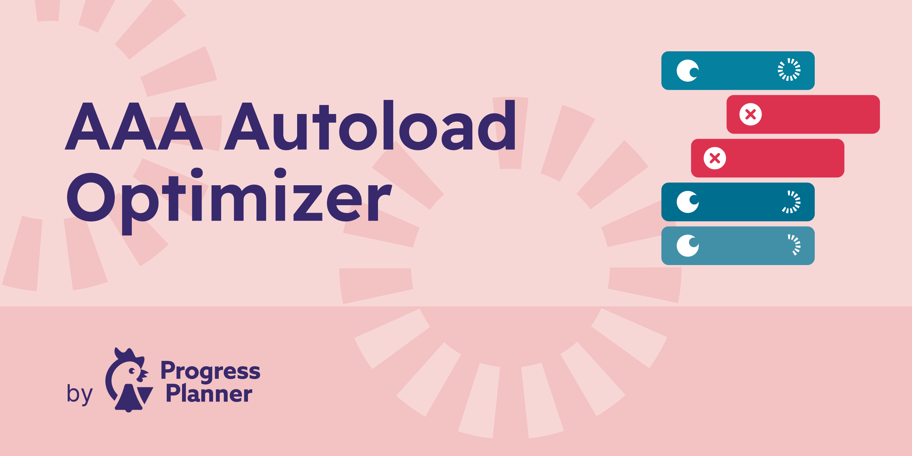

[](https://playground.wordpress.net/#%7B%22landingPage%22:%22/wp-admin/tools.php?page=aaa-option-optimizer%22,%22features%22:%7B%22networking%22:true%7D,%22steps%22:%5B%7B%22step%22:%22defineWpConfigConsts%22,%22consts%22:%7B%22IS_PLAYGROUND_PREVIEW%22:true%7D%7D,%7B%22step%22:%22login%22,%22username%22:%22admin%22,%22password%22:%22password%22%7D,%7B%22step%22:%22installPlugin%22,%22pluginZipFile%22:%7B%22resource%22:%22url%22,%22url%22:%22https://bypass-cors.altha.workers.dev/https://github.com/ProgressPlanner/aaa-option-optimizer/archive/refs/heads/develop.zip%22%7D,%22options%22:%7B%22activate%22:true%7D%7D%5D%7D)

# AAA Autoload Optimizer
This plugin tracks which of the autoloaded options are used on a page, and stores that data at the end of page render. It keeps an array of options that it has seen as being used. On the admin page, it compares all the autoloaded options to the array of stored options, and shows the autoloaded options that have not been used as you were browsing the site. If you've been to every page on your site, or you've kept the plugin around for a week or so, this means that those options probably don't need to be autoloaded.

## How to use this plugin
Install this plugin, and go through your entire site. Best is to use it normally for a couple of days, or to visit every page on your site and in your admin manually. Then go to the plugin's settings screen, and go through the unused options. You can either decide to remove an unused option (they might for instance be for plugins you no longer use), or to set it to not autoload. The latter action is much less destructive: it'll still be there, but it just won't be autoloaded.

## Frequently Asked Questions

### Why the AAA prefix in the plugin name?

Because the plugin needs to measure options being loaded, it benefits from being loaded itself first. As WordPress loads plugins alphabetically,
starting the name with AAA made sense.

### Do I need to take precautions?

Yes!! Backup your database.

### Who can view option values?

Every REST route requires `manage_options`. Option values can include API keys, SMTP passwords and licence keys, and the tables return these values to authorized administrators. This also applies to site administrators on multisite. Only enable the plugin where those administrators are trusted to inspect all site options.

### Which actions are protected?

Essential WordPress options, including site URLs, active plugins, theme settings and the current site's roles option, cannot be deleted, created with a false value, or have their autoload state changed through this plugin. Single and bulk deletion require confirmation in the admin screen. Autoload changes preserve the stored value and use WordPress's cache-aware autoload API.

### Why are unused-option recommendations paused?

Tracking retains at most 10,000 distinct names and records at most 1,000 distinct names per request. When a limit is reached or a tracking write fails, the plugin marks observations incomplete and pauses unused-option recommendations. Existing recorded counts can still increase. Older oversized tables are reduced to the limit on the next tracking write. Reset tracking to start a fresh observation period.

### How can I add recognized plugins?

Please do a pull request via GitHub on [this file](https://github.com/ProgressPlanner/aaa-option-optimizer/blob/develop/known-plugins/known-plugins.json) in the plugin.

### How can I report security bugs?

You can report security bugs through the Patchstack Vulnerability Disclosure Program. The Patchstack team help validate, triage and handle any security vulnerabilities. [Report a security vulnerability.](https://patchstack.com/database/vdp/aaa-option-optimizer)

## Development checks

Run `composer lint`, `composer check-cs`, `composer phpstan`, and `composer lint-known-plugins` with the development dependencies installed, and `npm run test:hardening:js` for the admin action regressions. The plugin-map validator requires an object keyed by plugin slug, with exactly a non-empty `name` and a non-empty array of unique string `option_prefixes` per entry.

Run `wp eval-file /path/to/aaa-option-optimizer/tests/hardening.php` only on a disposable WordPress installation with an administrator at user ID 1 and `define( 'AAAOO_DISPOSABLE_TEST_SITE', true );` in its configuration. The test creates and deletes fixtures and resets tracking data. It covers REST validation, exact option names, protected options, failed autoload updates, raw-value preservation, malformed sorting, and tracking limits.
